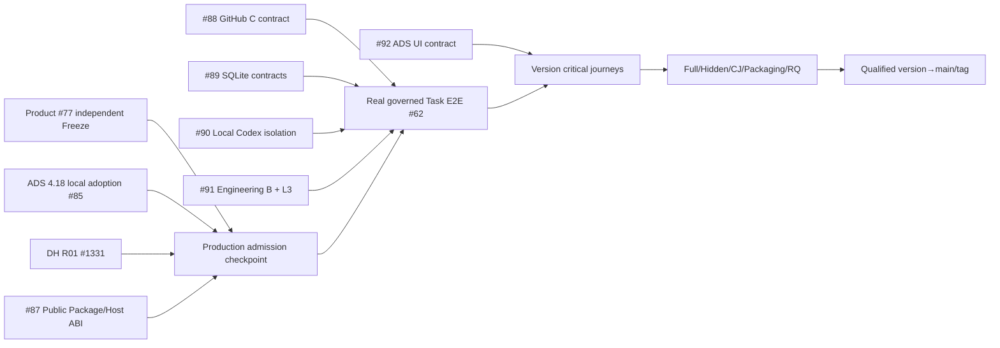

# Tally v2 — ADS v4.18 parallel Task DAG / Workfront R0

**Status:** PLANNING_ONLY; NATIVE_DEPENDENCIES_NOT_YET_WRITTEN; TASK_CLAIMS_NOT_ACCEPTED; PRODUCT_FREEZE=NO; L2_PHYSICAL_FREEZE=NO; RUNTIME_RELEASE=NOT_RUN; MAIN_MERGE=NO. Source owner [#86](https://github.com/kaicreator-mm/tally/issues/86).

## Exact governing sources and gate identities

- Target **ADS 4.18.0** standards Git source `main@2c395c55569fe2edf3f4135f12d3d069e526d0b7`; independently RQ READY, freeze candidate `ac7e7e51de3a7ac27343f16a96568c0b0f2c5349`, tree `cdf032f629668008a940993713a2bfaa219f5653`, [Release RQ evidence](https://github.com/kaicreator-mm/ai-development-standard/issues/1327#issuecomment-6401840670). Manual **Tally v2 adoption remains DRAFT** [#85](https://github.com/kaicreator-mm/tally/pull/85), exact H `bee79439d872107c8c62e48e2ab76de5c0555b79`; no project verifier execution or local compatibility Review yet. Historic Tally main ADS 1.2.1 unaffected; old v4.17 proposed Draft #81 superseded.
- DomainHarness v0.10.2 Task T09 external installed Tiny/Rich/producer independently PASS and **merged version-only** `v0.10.2@3a2ad3b88e149f19b1666bfbf5949420f51295cc`; its Release closeout [R01 #1331](https://github.com/kaicreator-mm/domain-harness/issues/1331) still OPEN; no official v0.10.2 Release PASS or main integration claimed. Scoped Node24 receipts may be reused, exact byte identities required.
- Product [#77](https://github.com/kaicreator-mm/tally/pull/77) exact `0d1f1a2e15581e300500bada6da54b2c9bcef75f`, 17 P0/47 Fxx/67 Vxx, distinct formal Product Freeze review pending. L2 semantic [#82](https://github.com/kaicreator-mm/tally/pull/82) reviewed previous candidate PASS with current source `ca39b7501d7d64a2068f1c416c7bf5fbe58fecba` narrower independent delta review pending. [F40 #84](https://github.com/kaicreator-mm/tally/issues/84): mandatory SQLite P0, Postgres optional.

## Decomposition principle

**Stage checkpoints:** Product+ADS adoption, L2 physical contract qualification, admitted Task Claims and Version RQ are governance checkpoints; they do not imply all child business work must be serial. **Workfronts:** independent contract/research/spec/fixture lanes can run immediately in parallel. Each production writer waits only on the exact minimum frozen source/ABI/permission predicates relevant to its concern. No extra mandatory workflow layer, fake Agent identity, second K, or all-workfront 'one PR'.

| Workfront | Native Issue | Independent source work NOW | Production dependency | Agent fit / reviewer |
|---|---|---|---|---|
| A Public DH consumer / Host | [#87](https://github.com/kaicreator-mm/tally/issues/87) | Public package export/manifest/ABI matrix + bounded experimental Node24 installed-consumer tests (source pinned) | R01 qualified DH release and accepted Tally L2 for production | Web API review + Local Codex/Claude Code physical; separate independent Reviewer |
| B GitHub native C | [#88](https://github.com/kaicreator-mm/tally/issues/88) | ADS 4.18 report/native fact contracts, source coverage and 403/partial/revision fixtures | Public C/Host ABI, effective ADS pin and current Product/L2 contracts | Web source/negative fixtures + later Host CLI; independent security Reviewer |
| C SQLite DB-neutral | [#89](https://github.com/kaicreator-mm/tally/issues/89) | Distinct K Host durable CAS/Journal/Effect vs GitHub-derived projection contracts; SQLite default; negative cases | DH Host confirmed public ABI; accepted Product/L2; K is sole authority | Web design + Node24 SQLite/Host specialist; independent durability reviewer |
| D Local Agent/Verifier | [#90](https://github.com/kaicreator-mm/tally/issues/90) | Codex capability/credential isolation, separate principal Hidden fixtures, typed errors, N=1 planning | Real public Host + privilege/ACL denial witnesses and accepted K permission gates | Web threat model, Windows/Ubuntu Local Agent, distinct safety Reviewer; operator only for actual OS principals |
| E Engineering B/L3 | [#91](https://github.com/kaicreator-mm/tally/issues/91) | Product/Task/Assurance/Experience B command/event/typed contract and Scaffold-aware Task DAG/L3 | Actual selected B/S/K ABI and accepted source before production Package publication | Web Product/architecture + Codex TS, distinct Contract/Code Reviewer |
| F Minimum ADS UI | [#92](https://github.com/kaicreator-mm/tally/issues/92) | Form/navigation/blocked-status/negative UX contracts across full ADS 4.18 lifecycle | Accepted B/K command contract and Host App Shell before implementing production UI | Web UX + Codex UI, separate Reviewer |

## Dependency graph (planning; not native Issue Dependencies)

Parallel contract and verification work is allowed **before** `GOV`; however there is **no executable implementation Task Claim** under this planning graph. Actual native GitHub blocked_by edges and accepted source-bound CAS Claim are required before Task Ready/Effect. Existence of Issues alone does not constitute `ready_builder`.

## Bounded Workfront execution and real critical path

1. **NOW — Web-first 6-lane source work:** #87 pin actual exported DH public symbols and Tiny/Rich limits; #88 source-qualified GitHub reader/publisher contract; #89 SQLite-first two bounded storage interfaces; #90 privilege and Hidden negative-fixture design; #91 B intent/event/Task Pack contracts; #92 minimal ADS UI journey. One concern/PR each, exact SHA P0/P1/P2 review. Where physical Local Agent is actually necessary, dispatch a short explicit task with Node24 commands and truthfully record exit; don't rerun final Full on every leaf.
2. **NOW — three independent gate lanes:** Product #77 distinct Reviewer; ADS v4.18 exact-source local root verifier + independent adoption PR #85; DH R01 #1331 full final Release Qualification by its own owner. L2 semantic #82 clean-source review can run in parallel. Do not force a serial `T11→T07→T09` style chain if an allowed workfront is independent.
3. **Then — physical selected public ABI Freeze:** Once R01 and source contracts are accepted, confirm installed BUILD selected K/S/B/C, Rich SQLite Host, external Consumer/Producer, Node24 exact tarball bytes. Version new Tally L2 physical contract and independent review.
4. **Then — minimal vertical slice #62:** One real ADS Task on real repository with Local Codex, scoped K→C GitHub permit/readback, SQLite CAS/restart, separate verifier access-deny; task-meta failure is nonblocking, Tally reads GitHub-published ADS report only. Anything mock-only or private DH imports does not pass.
5. **Then — integrate UI and version closure:** Comprehensive minimal ADS user journeys, actual Full/Hidden/Critical, package audit, exact Review/RQ and eventual version→main. `PR_PASS != RELEASE_PASS`. Do not retest unchanged Full on each leaf.

## Source/permission and exception discipline

- **Authority:** GitHub native issue/PR/review/CI/Task Report facts remain external; K Primary alone owns app State/Admission/Journal/Effect, Host persists via public API; SQLite GitHub projection is derived and invalidates safely. No Tally-owned replacement K; no task-meta private API.
- **Execution:** P0 max **N=1 executing Task Attempt** even if more nodes are Ready. One noninteractive Builder OS identity may not reach operator's GitHub push credentials/GCM/gh/SSH agent/sudo/admin, or Hidden verifier principal; exact denied probe required. Local Codex fake/unauthed yields `LOCAL_AGENT_UNAVAILABLE`, isolation failure yields `BUILDER_CONFINEMENT_UNAVAILABLE`; never collapse errors.
- **Human:** Operator intervention only where OS principal/secret provisioning, provider auth, protected external permission or live human-deny is genuinely needed; Web reviewer and CI/Local deterministic proof preferred. Distinct reviewer checks exact current SHA, not the author's prior verdict.
- **CI:** Historic Go PostgreSQL and gofmt failures [#83](https://github.com/kaicreator-mm/tally/issues/83) not magically fixed by SQLite P0 decision. Scope actual v2 Node24/SQLite/Host tests; status stays observed FAIL or NOT_RUN until authorized disposition.
- **No adaptive cross-version move:** accept old in-flight Task/Claim under their immutable former ADS revisions, never repin. This v2 design uses qualified ADS v4.18 *candidate* until project-local adoption/compatibility tests and authorized version-branch merge.

## Review / completion

Source-only initial deliverable ready for independent **ADS v4.18 Task DAG decomposition quality** review: minimal critical path, safe parallel workfronts, no false native edge, agent fit and human intervention, predecessor applicability and reusable physical T09 evidence. Real Task DAG admission = **NOT_RUN**; current child Issues [#87–#92](https://github.com/kaicreator-mm/tally/issues/86) are planned only. All production status stays `BLOCKED_PENDING_QUALIFIED_GATES`.
